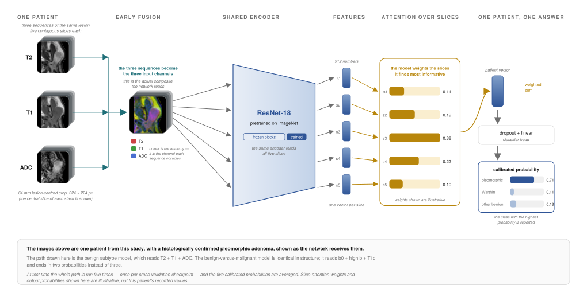

# parotid-mri-mil

Deep learning classification of parotid gland tumours on multi-parametric MRI, using a 2.5D
convolutional network with attention-based multiple-instance learning (MIL) over slices.

This is the code from my MD thesis, which I am now preparing for publication. It covers the
whole pipeline, from raw DICOM exports to the final evaluation on a held-out test set. The
images come from patients and cannot be shared, so the repository contains code only: no
images, labels or trained weights.

I looked at two questions:

- **binary**: is the tumour benign or malignant?
- **multiclass** (benign tumours only): is it a pleomorphic adenoma, a Warthin tumour, or another
  benign lesion?

## Pipeline

```
DICOM exports (.zip or folders)
  │ preprocessing/ingest_dicom.py   convert, classify series into T1 / T1c / T2 / B0 / DWI / ADC, pseudonymize
  │   [manual] pick one series where several candidates exist (selection CSV)
  ▼
NIfTI per patient
  │ preprocessing/preprocess.py     reorient, register to T1c, resample, mask, N4, normalize, crop
  │   [manual] place one fiducial at the tumour centre in 3D Slicer (F.mrk.json)
  ▼
co-registered volumes + tissue masks
  │ preprocessing/crop.py           fiducial-centred crops (64 mm, 11 x 224 x 224) as .npy
  ▼
  │ modeling/train.py               4-step cross-validated model selection on the training pool
  │ modeling/evaluate.py            fold-ensemble evaluation on the held-out test set
  ▼
tables, ROC / calibration / forest plots, Grad-CAM and attention case gallery
```

Two steps are manual on purpose. When a study contained several candidate series for the same
sequence, I chose the one with the best field of view and the fewest artefacts. And I marked the
tumour centre with a single point in 3D Slicer, which the crops are centred on.

## Why a custom preprocessing pipeline

Most open-source MRI pipelines are written for the brain: they skull-strip, expect the anatomy
in the middle of the field of view and register to a brain atlas. In the parotid region these
assumptions break down. The tumour sits laterally in the neck, often close to the edge of the
image. So I wrote my own pipeline:

- each patient's sequences are registered to that patient's contrast-enhanced T1 (T1 and T2
  rigidly; B0 affinely to T2 and from there to T1c), without an atlas;
- tissue masks come from intensity thresholds and morphology (a Li threshold for the structural
  images, a log-compressed Otsu threshold for the heavy-tailed EPI images), and the diffusion mask
  is limited to tissue that is also inside the structural mask;
- the structural images get N4 bias correction, every sequence is z-scored inside its mask, and
  ADC keeps its physical units;
- volumes are cropped to the tissue bounding box and padded, rather than centred on an assumed
  head centre.

The pipeline writes QA figures for every patient, and I checked its output by eye. More detail
in [preprocessing/README.md](preprocessing/README.md).

## Models

All models share an ImageNet-pretrained ResNet-18 encoder with only its last block trained; each
grey slice is copied into the three input channels. Training uses a focal loss with class weights
from each training fold, and AdamW with cosine decay. I built the models up in four steps, each
warm-started from the one before:

| Step | Input | Model |
|---|---|---|
| 1 | centre slice, one sequence | ResNet-18 + linear head |
| 2 | 5 central slices, one sequence | gated-attention MIL over slices (Ilse et al., 2018) |
| 3 | centre slice, 3 sequences | early (channel) fusion, late concat, or late sequence attention |
| 4 | 5 slices, 3 sequences | early / late / mid fusion with slice attention, or joint slice x sequence attention |

The sequence sets for step 3 are picked automatically from how each sequence ranked in steps 1
and 2, so they were not chosen by hand. Step 4 can also take age, sex and laterality through a
small clinical encoder.

The figure below follows one patient through a final step-4 model. The images are a
de-identified example from the study; the attention weights and probabilities are illustrative.



More detail in [modeling/README.md](modeling/README.md).

## How the models were validated

- Patients are split once, stratified by diagnosis, into a cross-validation pool (85%) and a
  held-out test set (15%). Only `evaluate.py` reads the test set.
- Every choice of sequences, architecture, epoch, threshold and temperature is made by 5-fold
  cross-validation on the pool. Within a fold, the ADC scaler is fitted on that fold's training
  patients, and warm-start weights come from the same fold of the previous step.
- The best epoch is picked on the validation fold that is then reported
  (`epoch_selection: outer_val`), and many configurations are compared on the same pool, so the
  cross-validated numbers are optimistic. I use them for model selection and treat the test set
  as the main result.
- On the test set, the five fold models act as an ensemble. Temperature scaling and, for the
  binary task, a Youden threshold are fitted on out-of-fold predictions from the pool; the binary
  call is the majority vote of the five models at that threshold. The 95% confidence intervals
  are bootstrap percentile intervals over test patients.

## Installation

```bash
pip install -r requirements.txt
```

If you have a GPU, install the CUDA build of PyTorch first. DICOM conversion also needs
[dcm2niix](https://github.com/rordenlab/dcm2niix). Python 3.10 or newer.

## Usage

The scripts expect the data outside the repository, or in a `data/` folder that git ignores:

```
data/
  dicom/                     raw exports (one .zip or folder per patient)
  nifti/<id>/                ingest_dicom.py output (+ F.mrk.json fiducial per patient)
  processed/<id>/            preprocess.py output
  crops/64mm/<id>_<seq>.npy  crop.py output
  labels.csv
```

`labels.csv` needs one row per patient with the columns `Scan_ID` (folder name), `DDx`
(1 pleomorphic adenoma, 2 Warthin tumour, 3 other benign, 4 malignant), `Sex` (M/F),
`Age` (years, or a DICOM age string such as `057Y`) and `Laterality` (R/L or Right/Left).

```bash
cd preprocessing
python ingest_dicom.py ../data/dicom ../data/nifti --id-map ../private/id_map.csv
python preprocess.py ../data/nifti ../data/processed --selection ../data/series_selection.csv
python crop.py ../data/processed ../data/crops --fiducial-dir ../data/nifti

cd ../modeling
python train.py --config config.yaml             # split, steps 1-4, diagnostics
python evaluate.py --config config.yaml
```

`python train.py --fast-run` runs the whole chain on a small subsample with two folds and two
epochs. It is a quick way to check a new installation.

## Reproducibility

- Registration samples voxels at random. `preprocess.py` fixes that sample with `--seed`
  (default 42). ITK still adds up the metric over several threads in a varying order, so two runs
  agree to rounding error but a registration can occasionally land slightly differently;
  `--threads 1` makes runs bit-identical, at the cost of a much longer run time.
- Each training fold gets its own seed, derived from the experiment, task and fold, which also
  covers the DataLoader workers, and cuDNN runs in deterministic mode. Two runs on the same GPU
  gave bit-identical checkpoints (GTX 1650 Ti, PyTorch 2.7.1, CUDA 11.8). A different GPU model, a
  different number of GPUs (`DataParallel` splits each batch, and BatchNorm statistics are
  computed per GPU) or other library versions can change the numbers.

## Repository layout

```
preprocessing/   ingest_dicom.py, preprocess.py, qa.py, crop.py, spacing_report.py
modeling/        config.yaml, data.py, models.py, metrics.py, engine.py, common.py, train.py, evaluate.py
docs/            figures
```

## License

MIT, see [LICENSE](LICENSE).
